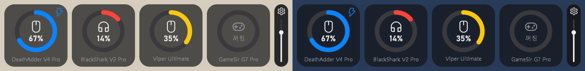

# Razer Battery Tray

Razer 무선 기기(마우스·헤드셋 등)와 GameSir G7 Pro 컨트롤러의 배터리 잔량을 **작업표시줄 트레이 아이콘**과 **바탕화면 위젯**으로 보여 주는 아주 가벼운 Windows 프로그램입니다.



> 위 그림은 마우스를 올린 상태의 위젯(가로 배치, 예시 값)입니다. 오른쪽의 톱니바퀴·세로 바는 마우스를 올렸을 때만 나타납니다.

## 무엇을 위한 프로그램인가요?

Razer Synapse는 배터리 잔량을 보려면 앱 창을 열어야 합니다. 이 프로그램은 잔량을 늘 보이는 곳(트레이 아이콘, 바탕화면)에 띄우고, 잔량이 부족하면 알림을 줍니다.

- **가볍습니다.** 메모리 약 1.5 MB, CPU는 평균 0.05% 이하입니다(5초 갱신 기준). Electron이나 GUI 프레임워크 없이 Win32 API를 직접 씁니다.
- **게임 보안 프로그램(뱅가드 등)에 걸릴 일을 하지 않습니다.** 다른 프로그램의 메모리를 읽거나, DLL을 주입하거나, 키보드·마우스를 후킹하거나, 장치에 직접 명령을 보내지 않습니다. 이미 디스크에 있는 Synapse 로그 파일을 읽고, Windows가 공식으로 제공하는 컨트롤러 API(XInput)만 씁니다.

## 어떻게 작동하나요?

```
Razer 기기 ──▶ Razer Synapse 4 ──▶ 로그 파일 (systray_systrayv2*.log)
                                          │  5초마다 새로 추가된 줄만 읽음
                                          ▼
GameSir G7 Pro ──▶ Windows XInput ──▶ 이 프로그램 ──▶ 트레이 아이콘 / 바탕화면 위젯 / 알림
```

1. **Razer 기기**: Synapse 4는 기기 목록과 배터리 상태(`powerStatus`)를 다음 로그에 JSON으로 남깁니다.
   `%LOCALAPPDATA%\Razer\RazerAppEngine\User Data\Logs\systray_systrayv2*.log`
   - 처음 실행할 때 모든 로그 파일을 한 줄씩 읽어 현재 상태를 만듭니다. 파일 전체를 메모리에 올리지 않습니다.
   - 그 뒤로는 주기마다(기본 5초) 각 파일에서 **지난번 이후 새로 추가된 부분만** 읽습니다. 덜 써진 마지막 줄은 다음으로 미루고, 파일이 교체되면(크기가 줄면) 처음부터 다시 읽습니다.
   - 로그가 여러 파일에 나뉘어 섞여 기록되므로 시각 순으로 정렬해서 적용합니다.
   - 해석 규칙:
     - `Charging`은 충전 중입니다.
     - `NoCharge_BatteryFull`은 "완충"이 아니라 "충전 안 함"이라는 뜻입니다.
     - `off`는 꺼짐입니다. 이때의 잔량은 믿지 않고, 꺼지기 전 마지막 잔량과 그 시각을 따로 보관합니다.
     - 기기 목록에 기기가 아예 없으면 연결이 끊긴 것(꺼짐)으로 봅니다.
   - Synapse는 잔량이 **1% 바뀔 때마다** 로그를 남기므로, 갱신 주기를 줄여도 값이 더 정확해지지는 않고 화면에 반영되는 시간만 빨라집니다.
2. **GameSir G7 Pro**: 2.4GHz 동글이나 USB 케이블로 연결하면 Windows에서 Xbox 방식 컨트롤러로 잡힙니다. XInput으로 배터리를 읽는데, XInput은 잔량을 %가 아니라 **4단계(거의 없음/낮음/보통/높음)**로만 알려 줍니다.

## 기능

### 트레이 앱 (`razer_battery_tray.exe`)
- 기기마다 트레이 아이콘 하나에 잔량 숫자를 표시합니다. GameSir는 막대 3칸으로 표시합니다.
- 툴팁에 이름, 잔량, 마지막 갱신 시각이 나옵니다. 꺼져 있으면 `꺼짐 (마지막 79%, 10/09 23:51)`처럼 보입니다.
- 잔량 부족 알림을 띄웁니다.
- 탐색기가 재시작되면 아이콘을 자동으로 다시 등록합니다.
- 중복 실행을 막습니다.
- 오른쪽 클릭 메뉴: 바탕화면 위젯 켜기/끄기, 설정, 종료

### 설정 창 (트레이 메뉴 "설정..." 또는 위젯 톱니바퀴)
| 항목 | 설명 |
|---|---|
| Windows 시작 시 자동 실행 | `HKCU\...\Run`에 등록 (관리자 권한 불필요) |
| 순서 ▲▼ | 위젯 타일 순서 |
| 위젯 / 작업표시줄 | 기기별로 위젯과 트레이 아이콘에 각각 띄울지 |
| 표시 이름 | 닉네임. 비우면 기본 이름 |
| 배터리 부족 기준 | 5~50% 미만 |
| 부족 알림 | 1분 / 3분 / 5분 / 15분 / 30분마다, 1번만, 알림 안 함 |
| 갱신 주기 | 1 / 5(추천) / 15 / 30 / 60초 |
| 위젯 배경 불투명도 | 배경만 투명해지고 글자·게이지·아이콘은 그대로 |

설정은 `%LOCALAPPDATA%\RazerBatteryTray\settings.ini`에 저장됩니다.

### 바탕화면 위젯
- 기기별 원형 게이지 타일입니다. 충전 중이면 타일 오른쪽 위에 번개가 표시됩니다.
- 항상 다른 창 **아래**, 바탕화면 바로 위에 있습니다. 게임이나 다른 창 위에 겹쳐 그리지 않습니다. Win+D(바탕화면 보기)를 누르면 보입니다.
- 마우스를 올리면 옆에 **톱니바퀴(설정)**와 **배경 불투명도 바**가 나타납니다.
- 끌어서 옮기면 위치를 기억합니다.
- **마우스 휠**로 전체 크기를 60~200%로 조절하고, 글자 크기도 함께 바뀝니다.
- 오른쪽 클릭 메뉴: 배치(2×2 / 가로 한 줄 / 세로 한 줄), 크기, 설정, 숨기기, 종료

### 잔량 색
| 상태 | 색 |
|---|---|
| 50% 이상 | 초록 |
| 15~49% | 노랑 |
| 15% 미만 | 빨강 |
| 충전 중 | 파랑 |
| 꺼짐·기록 없음 | 회색 |

## 설치

**요구 사항**: Windows 10/11 64비트, Razer Synapse 4 (Razer 기기용)

1. 이 저장소의 [`dist/razer_battery_tray.exe`](dist/razer_battery_tray.exe)를 내려받습니다.
   비공개 저장소라면 GitHub에 로그인한 상태에서 받아야 합니다.
2. 아무 폴더에나 두면 되지만 `%LOCALAPPDATA%\Programs\RazerBatteryTray\`를 추천합니다.
   **다운로드 폴더에서 바로 실행하지 마세요.** 다운로드 폴더에는 다른 사이트가 받아 둔 파일이 섞여 있을 수 있습니다.
3. 실행합니다. 서명되지 않은 프로그램이라 처음에는 Windows SmartScreen이 "Windows의 PC 보호" 창을 띄울 수 있습니다. **추가 정보 → 실행**을 누르면 됩니다.
4. 트레이 아이콘을 오른쪽 클릭 → 설정 → "Windows 시작 시 자동 실행"을 체크합니다.
5. Windows 11은 새 트레이 아이콘을 숨김 영역(^)에 넣습니다. 늘 보이게 하려면 **설정 → 개인 설정 → 작업 표시줄 → 기타 시스템 트레이 아이콘**에서 켜세요.

받은 파일이 맞는지 확인하려면 PowerShell에서 `Get-FileHash razer_battery_tray.exe`를 실행해 아래 값과 비교하세요.

```
SHA256  940CD95153FDE93453A44670C1B3F17AAF4AFE8FC126E655BC5DC4D7E02475A2
```

**제거**:
1. 설정에서 자동 실행을 끕니다.
2. 트레이 메뉴에서 종료합니다.
3. exe와 `%LOCALAPPDATA%\RazerBatteryTray` 폴더를 지웁니다.

## 다른 장치 추가하기

### Razer 기기 (Synapse가 배터리를 보여 주는 기기)

**1) productId 찾기.** 추가할 기기를 켜서 Synapse에 연결한 뒤, PowerShell에서 실행합니다.

```powershell
$log = "$env:LOCALAPPDATA\Razer\RazerAppEngine\User Data\Logs\systray_systrayv2*.log"
Get-Content $log | Select-String '"productId"' | ForEach-Object {
  $ids = [regex]::Matches($_.Line, '"productId":(\d+)') | ForEach-Object { $_.Groups[1].Value }
  $names = [regex]::Matches($_.Line, '"productName":\{"en":"([^"]*)"') | ForEach-Object { $_.Groups[1].Value }
  for ($i = 0; $i -lt [Math]::Min(@($ids).Count, @($names).Count); $i++) { "$(@($ids)[$i])`t$(@($names)[$i])" }
} | Sort-Object -Unique
```

출력 예:
```
122	Razer Viper Ultimate
124	Razer Deathadder V2 Pro
```

**2) [`src/parser.rs`](src/parser.rs)의 `TRACKED`에 한 줄 추가.** 배열 길이 숫자도 하나 늘립니다.

```rust
pub const TRACKED: [Tracked; 4] = [   // 3 → 4
    Tracked { product_id: 190, name: "Razer DeathAdder V4 Pro", short_name: "DeathAdder V4 Pro", kind: Kind::Mouse },
    Tracked { product_id: 1365, name: "Razer BlackShark V2 Pro", short_name: "BlackShark V2 Pro", kind: Kind::Headset },
    Tracked { product_id: 122, name: "Razer Viper Ultimate", short_name: "Viper Ultimate", kind: Kind::Mouse },
    Tracked { product_id: 124, name: "Razer DeathAdder V2 Pro", short_name: "DeathAdder V2 Pro", kind: Kind::Mouse }, // 추가
];
```

- `name`: 트레이 툴팁·알림용 이름
- `short_name`: 위젯 타일 아래 이름
- `kind`: 위젯 아이콘 종류. `Kind::Mouse`, `Kind::Headset`, `Kind::Keyboard`, `Kind::Other` 중 하나

나머지(트레이 아이콘, 위젯 타일, 설정 창의 행 수, 설정 파일)는 자동으로 따라옵니다.

**3) 다시 빌드**합니다(아래 "직접 빌드하기"). 장치 수가 바뀌면 저장된 타일 순서는 기본 순서로 돌아갑니다.

### Razer가 아닌 기기
로그 대신 다른 데이터 출처가 필요합니다. GameSir를 추가한 방식을 참고하세요.
- [`src/gamepad.rs`](src/gamepad.rs): 상태 해석
- [`src/tray.rs`](src/tray.rs)의 `read_pad`: 실제 읽기

뱅가드 같은 보안 프로그램과 부딪히지 않으려면 장치에 직접 명령을 보내는 방식(HID 등)은 피하고, Windows가 공식으로 제공하는 API만 쓰는 것을 권장합니다.

## 직접 빌드하기

**Windows에서**:
1. [rustup](https://rustup.rs)과 Visual Studio Build Tools(C++)를 설치합니다.
2. 실행합니다.
   ```
   cargo build --release
   ```
3. 결과: `target\release\razer_battery_tray.exe`

**WSL/Linux에서 교차 빌드**: MinGW-w64가 필요합니다(`x86_64-w64-mingw32-gcc-posix`, `x86_64-w64-mingw32-windres`).
```
rustup target add x86_64-pc-windows-gnu
cargo build --release --target x86_64-pc-windows-gnu
```

**테스트**: 파서는 Win32 코드와 분리돼 있어 어느 OS에서나 돌아갑니다. 실제 로그 폴더가 있으면 그걸로도 테스트합니다(`RAZER_LOG_DIR`로 위치 지정 가능).
```
cargo test
```

## 코드 구성

| 파일 | 역할 |
|---|---|
| `src/parser.rs` | 로그 한 줄 해석, 기기 상태, **추적 기기 목록(`TRACKED`)** |
| `src/watcher.rs` | 로그 파일들을 오프셋 기반으로 이어 읽기 |
| `src/gamepad.rs` | XInput 컨트롤러 상태 해석 |
| `src/config.rs` | 설정 파일, 잔량 부족 알림 주기 |
| `src/tray.rs` | 트레이 아이콘, 메시지 루프, 앱 상태 (Win32) |
| `src/widget.rs` | 바탕화면 위젯 그리기·조작 (Win32) |
| `src/settings.rs` | 설정 창 (Win32) |
| `src/syslib.rs` | System32에서만 불러오는 DLL 함수 (DLL 바꿔치기 방지) |
| `tests/real_logs.rs` | 실제 로그 폴더로 하는 테스트 |

## 리소스·안전 점검 결과

**리소스** (실측, 5초 갱신)
- 메모리: 개인 작업 집합 약 1.5 MB
- CPU: 2분간 31 ms (약 0.03%)
- 스레드: 4개
- 장시간 실행: GDI 개체와 핸들 수가 늘지 않음
- 갱신 주기별 CPU: 1초 약 0.13%, 5초 약 0.05%, 30초 0.03% 이하. 메모리는 주기와 무관

**보안 프로그램(안티치트)과의 충돌 가능성**: 아래 동작을 하지 않습니다.
- 다른 프로세스 메모리 읽기·쓰기
- DLL 주입, 전역 후킹(`SetWindowsHookEx`)
- 드라이버 설치
- 장치에 직접 HID 명령 보내기
- 키보드·마우스 입력 흉내 내기
- 게임 위에 오버레이 그리기
- 네트워크 사용

**보안 점검**
- 네트워크 통신이 없고 관리자 권한도 요구하지 않습니다(`asInvoker`).
- **DLL 바꿔치기 방지**: Windows 보호 목록(KnownDLLs)에 없는 `xinput1_4.dll`, `uxtheme.dll`, `dwmapi.dll`은 System32에서만 불러옵니다.
- **비정상 입력 대비**:
  - 로그 한 줄은 최대 1 MB까지만 읽습니다(줄바꿈 없는 비정상 파일 대비).
  - JSON이 깨진 줄은 건너뜁니다.
  - 닉네임은 40자로 자릅니다.
  - 그림 버퍼를 만들지 못하면 그리기를 건너뜁니다.
- 자동 실행 경로는 따옴표로 감싸 저장합니다(경로에 공백이 있을 때 다른 exe가 실행되는 문제 방지).

## 알려진 한계

- **Razer 기기는 Synapse 4가 실행 중이어야** 합니다. Synapse의 로그 형식이 바뀌면 고쳐야 할 수 있습니다.
- **GameSir G7 Pro는 실제 기기로 테스트하지 못했습니다.** 컨트롤러가 XInput으로 배터리를 보고하지 않으면 "연결됨 (잔량 정보 없음)"으로만 보입니다. 여러 XInput 컨트롤러가 연결돼 있으면 Windows가 먼저 잡은 하나만 표시합니다.
- 작업표시줄 아이콘을 전부 끄면 잔량 부족 알림을 띄울 곳이 없어 알림이 나오지 않습니다.
- 위젯 아이콘은 Windows 11의 Segoe Fluent Icons 글꼴을 쓰고, Windows 10에서는 Segoe MDL2 Assets로 대신합니다.
